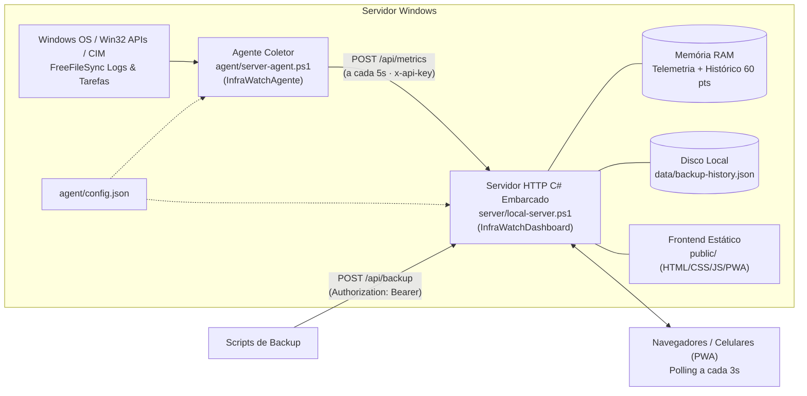

# Documentação Técnica — InfraWatch

Referência de arquitetura, instalação, configuração, API HTTP, segurança e testes do **InfraWatch**, dashboard web 100% local para monitoramento em tempo real de servidores Windows.

---

## 1. Visão Geral e Arquitetura

O projeto utiliza exclusivamente recursos nativos do Windows (**PowerShell 5.1+**, **.NET Framework** e **APIs Win32**), dispensando Node.js, Python, Docker ou bancos de dados externos.



### Componentes principais

1. **Servidor HTTP (`server/local-server.ps1`)**: compila em memória a classe C# `InfraWatchLocalServer` usando `TcpListener` e `ThreadPool`. Carrega `apiKey` e `backup.apiToken` automaticamente de `agent/config.json`, mantém os últimos **60 pontos** de telemetria em RAM e persiste até **200 registros** de backup em `data/backup-history.json`.
2. **Agente Coletor (`agent/server-agent.ps1`)**: compila as classes P/Invoke `InfraWatchCpuNative` (`kernel32.dll`) e `InfraWatchSessionNative` (`wtsapi32.dll`) para coleta precisa independente do idioma do Windows, com fallbacks WMI/CIM.
3. **Frontend (`public/`)**: aplicação *Single Page* em HTML5, CSS3 e JavaScript puro (sem CDNs), com gráficos SVG, tema claro/escuro (`localStorage`: `infrawatch-theme`), PWA e modo Demo autônomo (`?demo=1`, `file://` ou hosts estáticos).

---

## 2. Instalação e Operação

### Pré-requisitos
- Windows 10, Windows 11 ou Windows Server (PowerShell 5.1+).
- Privilégios de **Administrador** para instalar serviços e regras de firewall.

### Instalação automática
1. Copie a pasta do projeto para um diretório fixo (ex.: `C:\InfraWatch`).
2. Execute **`Gerenciador.bat`** e escolha **`[1] Iniciar dashboard`**. Se ainda não estiver instalado, ele executará `scripts\instalar.ps1` automaticamente.

Via PowerShell (como Administrador):
```powershell
powershell -NoProfile -ExecutionPolicy Bypass -File "C:\InfraWatch\scripts\instalar.ps1"
```
Para escolher outra porta inicial (padrão `80`, fallback `3000`):
```powershell
powershell -NoProfile -ExecutionPolicy Bypass -File "C:\InfraWatch\scripts\instalar.ps1" -PreferredPort 8080
```

O instalador realiza automaticamente:
- Criação de `agent/config.json` a partir de `agent/config.example.json` (caso não exista).
- Geração automática de chaves aleatórias únicas (32 bytes hex) para `apiKey` e `backup.apiToken` quando estiverem com valores placeholder.
- Teste de disponibilidade da porta (`80` ou fallback `3000`).
- Atualização de `endpointUrl` em `agent/config.json`.
- Criação da regra de firewall `InfraWatch - Dashboard Local` para redes locais e VPN (`LocalSubnet`, `10.0.0.0/8`, `172.16.0.0/12`, `192.168.0.0/16`, `26.0.0.0/8`).
- Registro e inicialização das tarefas agendadas `InfraWatchDashboard` e `InfraWatchAgente` sob a conta `SYSTEM` (`AtStartup`).

### Execução manual (desenvolvimento / testes)

```powershell
# Servidor HTTP
powershell -NoProfile -ExecutionPolicy Bypass -File "server\local-server.ps1" -Port 3000

# Agente (execução contínua)
powershell -NoProfile -ExecutionPolicy Bypass -File "agent\server-agent.ps1"

# Agente (apenas exibir JSON no console sem enviar)
powershell -NoProfile -ExecutionPolicy Bypass -File "agent\server-agent.ps1" -ConfigPath "agent\config.example.json" -DryRun

# Suite de verificação automatizada
powershell -NoProfile -ExecutionPolicy Bypass -File "tests\Test-InfraWatch.ps1"
```

### Modo Demo autônomo (hospedagem estática)
A pasta `public/` utiliza caminhos relativos (`./styles.css`, `./app.js`, `./manifest.json`) e ativa automaticamente o modo Demo sem requisições à API quando acessada via:
- Parâmetro `?demo=1` ou `?demo=true` (opcionalmente `?theme=light` ou `?theme=dark`).
- Protocolo `file://` ou domínios estáticos (`*.github.io`, `*.vercel.app`, `*.netlify.app`, `*.pages.dev`).

### Desinstalação
```powershell
powershell -ExecutionPolicy Bypass -File "C:\InfraWatch\scripts\desinstalar.ps1"
```

### Nome amigável opcional (ex.: `http://monitor.local`)
Configure um registro de DNS local no roteador apontando `monitor.local` para o IP do servidor, ou adicione no arquivo `C:\Windows\System32\drivers\etc\hosts` das estações:
```text
<ip-do-servidor>   monitor.local
```

---

## 3. Configuração (`agent/config.json`)

O modelo versionado fica em `agent/config.example.json`. O arquivo real `agent/config.json` é ignorado pelo `.gitignore` para evitar exposição de chaves locais.

```json
{
  "serverId": "servidor-local",
  "serverLabel": "Servidor Local",
  "endpointUrl": "http://127.0.0.1:80/api/metrics",
  "apiKey": "CHANGE_ME_ON_INSTALL",
  "intervalSeconds": 5,
  "gatewayToPing": "192.168.1.1",
  "watchedServices": [
    { "name": "LanmanServer", "label": "Compartilhamento (SMB)" },
    { "name": "TermService",  "label": "Área de Trabalho Remota" },
    { "name": "Spooler",      "label": "Spooler de Impressão" }
  ],
  "backup": {
    "label": "FreeFileSync → OneDrive",
    "apiToken": "CHANGE_ME_ON_INSTALL",
    "warnAfterHours": 24,
    "criticalAfterHours": 48,
    "logPaths": [],
    "destinationPaths": [],
    "taskNameContains": ["FreeFileSync", "FileSync", "RealTimeSync", "Backup", "OneDrive"]
  }
}
```

| Campo | Descrição |
|---|---|
| `serverId` / `serverLabel` | Identificador e título exibido no cabeçalho da dashboard |
| `endpointUrl` | URL de envio dos heartbeats (`POST /api/metrics`), ajustada pelo instalador |
| `apiKey` | Chave enviada no cabeçalho `x-api-key` (gerada automaticamente na instalação) |
| `intervalSeconds` | Intervalo de coleta em segundos (mínimo `2`, padrão `5`) |
| `gatewayToPing` | IP testado via ICMP (timeout 800 ms) |
| `watchedServices` | Lista de serviços Windows monitorados via `Get-Service` |
| `backup.*` | Token Bearer, limites de alerta (24h/48h) e caminhos extras de logs/destino |

> **Extensibilidade**: adicione verificações customizadas na função `Get-CustomExtras` em `agent/server-agent.ps1` para exibi-las automaticamente no card **Serviços & Verificações**.

---

## 4. Referência da API HTTP

Todas as rotas retornam JSON UTF-8 com `Cache-Control: no-store`, `X-Content-Type-Options: nosniff`, `X-Frame-Options: DENY` e `Referrer-Policy: no-referrer`. CORS é restrito à mesma origem por padrão (configurável via `-CorsOrigin`).

| Método | Rota | Autenticação | Descrição |
|---|---|---|---|
| `GET` | `/api/health` | Pública | Healthcheck do servidor HTTP |
| `GET` | `/api/metrics` | Pública | Status (`online`/`offline`/`waiting`), última leitura e histórico (60 pts) |
| `POST` | `/api/metrics` | `x-api-key` | Recebe heartbeat do agente (comparação em tempo constante) |
| `DELETE` | `/api/metrics` | `x-api-key` | Limpa telemetria e histórico em memória |
| `GET` | `/api/backup` | Pública | Último backup, flags 24h/48h e histórico (até 200 registros) |
| `POST` | `/api/backup` | `Authorization: Bearer` | Registra execução de backup em `data/backup-history.json` |
| `DELETE` | `/api/backup` | `Authorization: Bearer` | Limpa histórico de backups |
| `GET` | `/*` | Pública | Serve arquivos estáticos de `public/` com proteção contra *path traversal* |

### Exemplo de envio para `POST /api/backup`

Campos aceitos: `tarefa` (obrigatório), `status` (`sucesso` | `aviso` | `erro` | `cancelado`, obrigatório), `agendamento`, `codigo` e `maquina`.

```powershell
$cfg = Get-Content "C:\InfraWatch\agent\config.json" -Raw | ConvertFrom-Json
$body = @{
    tarefa      = "Backup_Diario_OneDrive"
    agendamento = "Diário 02:00"
    status      = "sucesso"
    codigo      = 0
    maquina     = $env:COMPUTERNAME
} | ConvertTo-Json -Compress

Invoke-RestMethod `
  -Uri "http://127.0.0.1/api/backup" `
  -Method Post `
  -Headers @{ Authorization = "Bearer $($cfg.backup.apiToken)" } `
  -Body ([System.Text.Encoding]::UTF8.GetBytes($body)) `
  -ContentType "application/json; charset=utf-8"
```

---

## 5. Segurança, Limitações e Solução de Problemas

### Boas práticas e limitações conhecidas
- **Rede autorizada**: não exponha a porta HTTP diretamente à internet. Caso precise de acesso externo ou criptografia em trânsito, utilize um proxy reverso com HTTPS/TLS e camada de autenticação.
- **Rotas de leitura (`GET`)**: `GET /api/metrics` e `GET /api/backup` não exigem login por padrão na LAN autorizada, o que significa que nomes de usuários, compartilhamentos SMB, IPs e processos ficam visíveis a clientes da rede permitida.
- **Permissões NTFS**: como as tarefas agendadas rodam sob `SYSTEM`, restrinja o acesso de escrita à pasta de instalação e ao arquivo `agent/config.json` apenas para Administradores e `SYSTEM`.
- **Integridade de backups**: o card de backup monitora o recebimento de notificações (`POST /api/backup`) e logs do FreeFileSync; isso **não** garante a integridade física ou a capacidade de restauração dos arquivos — realize testes periódicos de restore.

### Solução de problemas
- **Dashboard não abre na porta 80**: abra `Gerenciador.bat` e verifique se o serviço subiu na porta `3000` (fallback automático).
- **Status fica em `AGUARDANDO` ou `OFFLINE`**: confira no `Gerenciador.bat` se a coleta está ativa e se `endpointUrl` e `apiKey` em `agent/config.json` estão corretos.
- **Alterações em scripts `.ps1` não aplicam**: abra `Gerenciador.bat` e escolha **`[2] Reiniciar dashboard`**.
