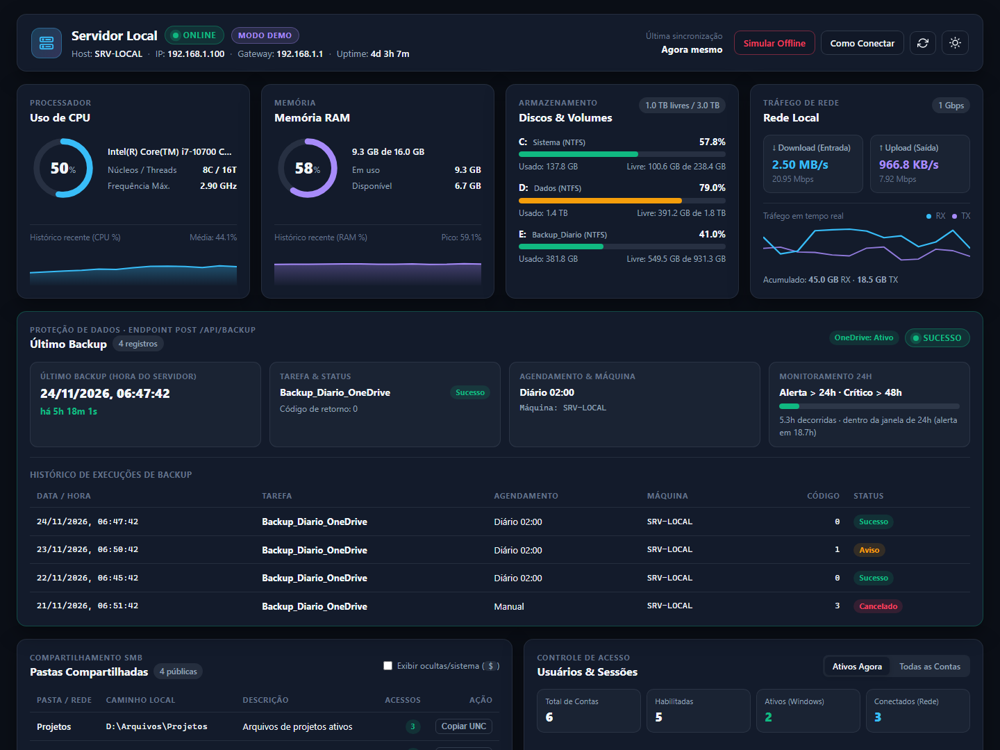
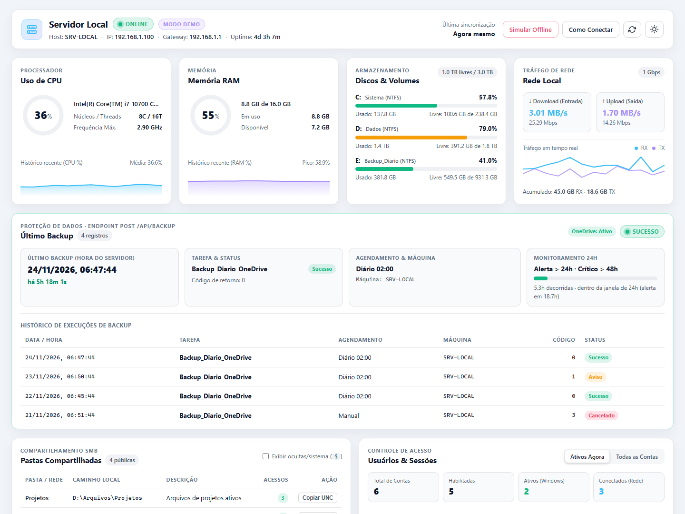
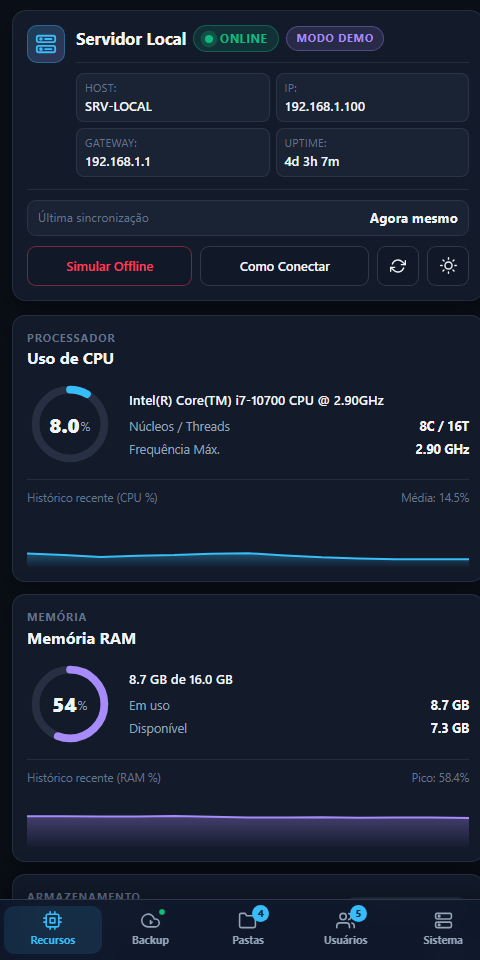
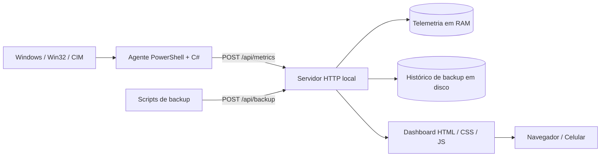

<div align="center">
  
  <h1>InfraWatch</h1>
  <p><strong>Real-time Windows Server Monitoring</strong></p>
  <p>Dashboard web para monitoramento de servidores Windows em tempo real, com operação 100% local e sem dependências externas de runtime.</p>
  <p>
    
    
    
    
    
  </p>
  <p>
    <a href="#funcionalidades">Funcionalidades</a> ·
    <a href="#arquitetura">Arquitetura</a> ·
    <a href="#instalação">Instalação</a> ·
    <a href="#segurança">Segurança</a> ·
    <a href="DOCUMENTACAO.md">Documentação técnica</a>
  </p>
</div>

<p align="center">
  
</p>

## Sobre o projeto

O **InfraWatch** foi desenvolvido para simplificar o acompanhamento de infraestrutura Windows em redes locais, reunindo telemetria de hardware, conectividade, compartilhamentos SMB, sessões de usuários, serviços e backups em uma única interface web responsiva.

A solução combina um agente de coleta em **PowerShell + C# (Win32 P/Invoke)**, um servidor HTTP TCP embarcado e uma interface *Single Page* em **HTML5, CSS3 e JavaScript puro**. Não exige Node.js, Python, Docker, IIS ou banco de dados externo para operar.

## Funcionalidades

| Recurso | Descrição |
|---|---|
| **Disponibilidade** | Status `ONLINE` / `OFFLINE` automático com alerta visual após ausência de heartbeats |
| **CPU e RAM** | Coleta nativa via `kernel32.dll` (`GetSystemTimes`), medidores radiais e gráficos históricos SVG |
| **Armazenamento** | Espaço utilizado e livre em todos os volumes fixos com alertas visuais (≥ 75% e ≥ 90%) |
| **Rede** | Velocidade de download (RX) e upload (TX), tráfego acumulado e adaptadores ativos |
| **Backups** | Histórico via `POST /api/backup` persistido em disco, autodescoberta FreeFileSync/OneDrive e alertas de atraso (> 24h / > 48h) |
| **Compartilhamentos SMB** | Pastas compartilhadas, filtro de compartilhamentos ocultos (`$`), acessos ativos e cópia rápida de caminho UNC |
| **Usuários e sessões** | Contas locais, sessões interativas/RDP (via `wtsapi32.dll`) e conexões SMB ativas |
| **Serviços e processos** | Status de serviços Windows configuráveis, latência ICMP do gateway e Top 6 processos por RAM |
| **Interface e Modo Demo** | Tema claro/escuro, layout responsivo, suporte PWA e modo Demo autônomo (`public/index.html?demo=1`) |

## Interface

| Tema Claro (Desktop) | Responsivo (Mobile / PWA) |
| :---: | :---: |
|  |  |

## Arquitetura



O agente coleta métricas a cada **5 segundos** por padrão e envia heartbeats autenticados (`x-api-key`) ao servidor HTTP local. O servidor mantém uma janela circular de até **60 pontos** de telemetria em memória e persiste até **200 registros** de backup em `data/backup-history.json`.

Consulte a [documentação técnica](DOCUMENTACAO.md) para detalhes completos da API, configuração e arquitetura.

## Tecnologias

- **PowerShell 5.1+ e .NET Framework** — orquestração do agente, servidor e automação de deploy
- **C# e APIs Win32 (`kernel32.dll`, `wtsapi32.dll`)** — coleta de CPU/sessões independente de idioma e servidor HTTP `TcpListener`
- **HTML5, CSS3 e JavaScript puro** — frontend sem frameworks ou etapa de build, com gráficos vetoriais SVG
- **HTTP/JSON e PWA** — API REST local, manifesto web e navegação responsiva para celular
- **Agendador de Tarefas e Firewall do Windows** — execução em segundo plano como serviço local

## Instalação

### Pré-requisitos

- Windows 10, Windows 11 ou Windows Server.
- Windows PowerShell 5.1 ou superior.
- Privilégios administrativos para registrar as tarefas agendadas e a regra de firewall.

### Passo a passo

1. Clone o repositório:

   ```bash
   git clone https://github.com/unnebell/Infra-Watch.git
   ```

2. Coloque os arquivos em um diretório fixo no servidor (ex.: `C:\InfraWatch`) com permissão de escrita restrita a Administradores e `SYSTEM`.
3. Execute **`Gerenciador.bat`**, aceite a elevação de privilégios e selecione **`[1] Iniciar dashboard`**.
4. Acesse **`http://<nome-do-servidor>`** ou **`http://<ip-do-servidor>`** em um navegador da rede autorizada (caso a porta `80` esteja ocupada, o instalador utiliza automaticamente a porta `3000`).

> Na primeira instalação, o instalador cria `agent/config.json` a partir de `agent/config.example.json` e gera automaticamente chaves aleatórias únicas para `apiKey` e `backup.apiToken`.

### Operação e desinstalação

- **Gerenciamento diário**: execute `Gerenciador.bat` para iniciar, reiniciar, encerrar ou consultar o status dos serviços.
- **Modo Demo sem servidor**: abra `public/index.html?demo=1` diretamente no navegador (ou publique a pasta `public/` em hospedagem estática).
- **Desinstalação**: execute no PowerShell como Administrador:

  ```powershell
  powershell -ExecutionPolicy Bypass -File "C:\InfraWatch\scripts\desinstalar.ps1"
  ```

### Verificação automatizada

Para validar sintaxe PowerShell, JSON, modo `-DryRun` do agente e endpoints/autenticação da API HTTP localmente:

```powershell
powershell -NoProfile -ExecutionPolicy Bypass -File "tests\Test-InfraWatch.ps1"
```

## Estrutura do projeto

```text
Infra-Watch/
├── agent/              # Agente de coleta (server-agent.ps1) e modelo config.example.json
├── docs/images/        # Capturas reais da interface em modo Demo
├── public/             # Dashboard web estática (HTML, CSS, JS e PWA)
├── scripts/            # Instalador (instalar.ps1) e desinstalador (desinstalar.ps1)
├── server/             # Servidor HTTP C# embarcado em PowerShell (local-server.ps1)
├── tests/              # Suite de verificação automatizada (Test-InfraWatch.ps1)
├── Gerenciador.bat     # Painel interativo operacional
├── DOCUMENTACAO.md     # Referência técnica completa
└── README.md           # Apresentação e guia rápido
```

## Segurança

- O **InfraWatch** é projetado para redes locais ou VPNs autorizadas; **não exponha suas portas diretamente à internet** sem proxy reverso com HTTPS/TLS e autenticação.
- Chaves de escrita (`x-api-key` e `Authorization: Bearer`) são geradas automaticamente por instalação em `agent/config.json` (ignorado no Git) e validadas com comparação em tempo constante.
- As rotas de leitura (`GET /api/metrics` e `GET /api/backup`) permanecem abertas na rede autorizada para facilitar o acesso rápido via navegador; avalie essa exposição antes de utilizar em ambientes com requisitos estritos de sigilo.
- Como as tarefas agendadas executam sob `SYSTEM`, restrinja as permissões NTFS da pasta de instalação para impedir edição por usuários sem privilégios.
- O registro de sucesso em `/api/backup` confirma a notificação da rotina executada, **não** substituindo testes periódicos de integridade e restauração dos arquivos.

## Documentação

Consulte [DOCUMENTACAO.md](DOCUMENTACAO.md) para detalhes de configuração, endpoints da API HTTP e solução de problemas.
